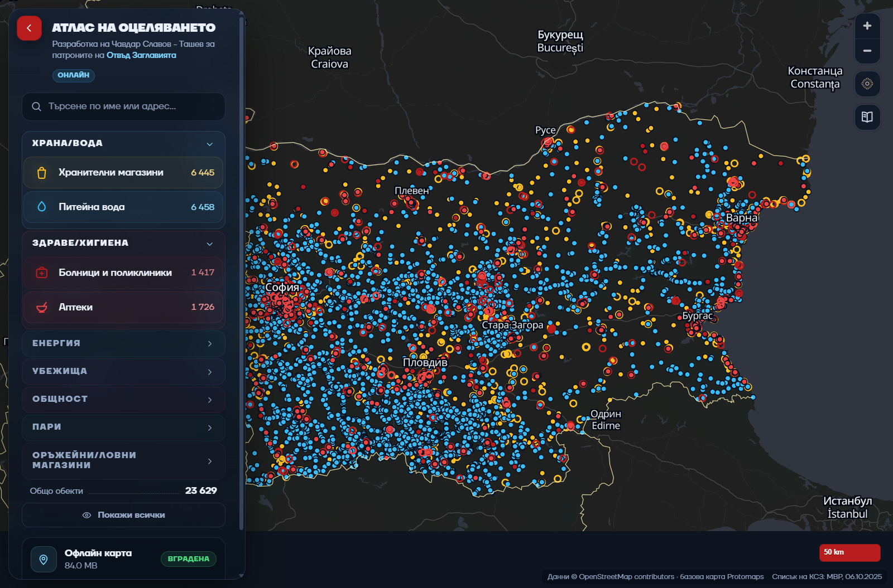

# АТЛАС НА ОЦЕЛЯВАНЕТО

Офлайн карта на обекти за оцеляване в България: храна и вода, здраве, спешни служби,
енергия, убежища, снабдяване, общност, комуникации, пари и оръжейни магазини —
**19 слоя с 25 049 точки**. С GPS локация, „Близо до мен“, търсене на място и по
координати, настройки на картата и вградена библиотека с документи — всичко работи
без интернет.

## Изтегляне

**[Последна версия](https://github.com/otvadzaglaviata-cloud/atlas-na-otselyavaneto/releases/latest)**

- **Windows 10/11, 64-bit** — инсталаторът е около 89 MB и съдържа базовата карта.
  След инсталация приложението работи напълно без интернет. Инсталира се за текущия
  потребител, без администраторски права.
- **Android 7+ (arm64)** — подписан APK в същото издание. Разреши инсталация от
  неизвестни източници за браузъра или файловия мениджър, с който отваряш файла.

## Инсталация

### Windows

1. Свали `Atlas-…-x64-setup.exe` от последната версия.
2. Windows SmartScreen може да покаже „Windows protected your PC“, защото инсталаторът
   още не е подписан: **More info → Run anyway**.
3. Next → Install. Готово.

### Android

1. Свали `Atlas-…-android-arm64.apk` от последната версия.
2. Отвори файла и разреши инсталация от този източник, ако телефонът поиска.
3. Инсталирай. Приложение от същия подпис се обновява върху предишната версия.

## Какво има вътре

- **25 049 обекта в 19 слоя**, подредени в десет секции на панела:
  - **Храна/Вода** — хранителни магазини (6 445), питейна вода (6 458);
  - **Здраве/Хигиена** — болници и поликлиники (1 417), аптеки (1 726);
  - **Спешни служби** — полиция (279), пожарна (156);
  - **Енергия** — бензиностанции (1 963), обществени зарядни станции (893);
  - **Убежища** — убежища и скривалища (247), хижи и заслони (587), манастири (101);
  - **Снабдяване и инструменти** — природа и риболов (88), железария и инструменти
    (544), големи вериги (53);
  - **Общност** — читалища (738), общини и кметства (1 118);
  - **Комуникации** — обществен Wi-Fi (554 обекта: кафенета, библиотеки, гари, молове,
    общини, пощи и други публични места);
  - **Пари** — банкомати (1 635);
  - **Оръжейни/Ловни магазини** — 47 обекта.
- **Обществен Wi-Fi** — 554 публични точки. Детайлите показват вида на мястото, дали
  мрежата е безплатна или платена, и SSID, когато е известен.
- **Големи вериги** — Метро е добавено към Практикер, Бриколаж и Декатлон (53 обекта).
  Хранителните обекти от големите вериги са с по-едри маркери за по-бързо намиране.
- **Близо до мен** — GPS бутон, радиус 500 м / 1 / 2 / 5 км, бройки по категории,
  списък с разстояние и посока и кръг на картата. Тап на обект центрира картата и
  отваря детайлите. В панела има точни координати, точност, копиране и SMS (Android).
- **Търсене на място** — офлайн индекс на 7 741 населени места; предложения при 2+
  букви, центриране и „Обекти в <място>“ с радиус и всички категории.
- **Търсене по координати** — десетични координати (ширина, дължина) с точка или
  запетая; центрира, маркира точката и показва обектите около нея.
- **Настройки на картата** — gear под библиотеката: контраст, наситеност, вода,
  земя/паркове, пътища, сгради, размер на надписите и размер на точките (50–150%),
  компактно меню и връщане по подразбиране. Промените се пазят на устройството.
- **Библиотека с документи** — бутон с разтворена книга отваря офлайн документи:
  „Раница за бедствия“, „Правила при бедствия“, „Сигнали и BG-ALERT“ и списъка на
  колективните средства за защита от МВР. Всичко е в приложението, без мрежа.
- **GPS локация** — центрира и приближава до позицията ти, показва маркер с кръг на
  точността и режим на следене. Координатите не напускат устройството.
- **Панел** — при старт всички слоеве са включени, а секциите са свити; така веднага
  се вижда пълният обхват на картата. Затворена секция с включени слоеве показва
  брояч и светещо заглавие. Бутонът „Скрий всички“ изчиства картата с един клик.
- **Избрана точка** — около обекта, чиито детайли са отворени, се появява ясен глоу,
  за да не се губи коя точка е избрана в натоварени градски райони.
- Тъмна карта на България с надписи на населените места и бледожълта държавна граница.
- Цялата карта и данни са в инсталатора; офлайн работа от първия старт.

## Лиценз и кредити

- Кодът е **proprietary** — виж [LICENSE](LICENSE). Приложението се ползва безплатно;
  не се продава и не се препубликува като нова версия.
- Данните от OpenStreetMap са под **ODbL 1.0**; базовата карта е Protomaps.
- Списъкът на колективните средства за защита е от **МВР, 06.10.2025**; координатите са
  геокодирани през OpenStreetMap.
- Правилата за безопасно поведение, раницата за бедствия и сигналите са адаптирани от
  официалните материали на **МВР/ГДПБЗН**; BG-ALERT — от официалния сайт на системата.
- Пълните кредити и лицензи: [ATTRIBUTION.md](ATTRIBUTION.md).

## Подкрепа

Проектът се развива благодарение на патроните на **Отвъд Заглавията**:
<https://www.patreon.com/c/beyondheadlines>
